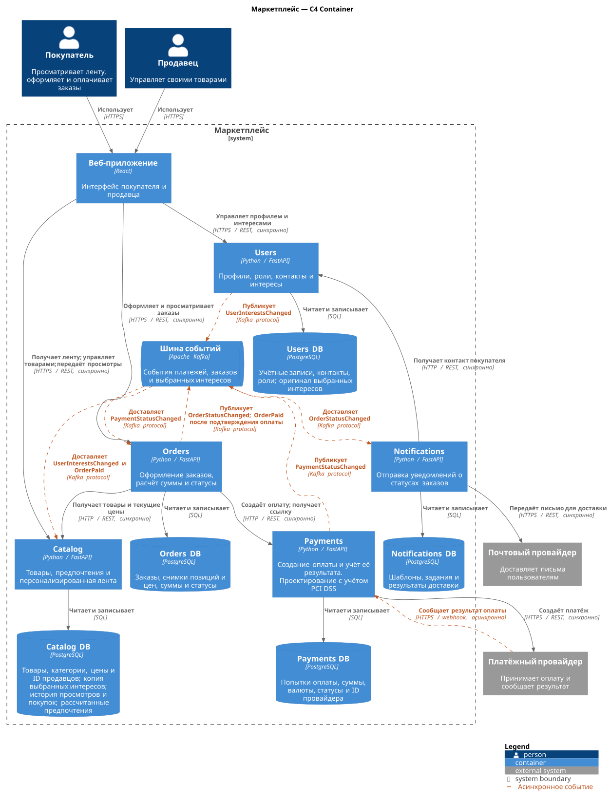

# Маркетплейс: архитектура и каркас сервиса

Учебный проект по архитектурному проектированию. Продавцы размещают товары, покупатели получают персональную ленту и оформляют заказы. Система рассчитывает сумму заказа, учитывает платежи и сообщает об изменении статуса заказа.

В репозитории описана архитектура всей системы, а реализован только каркас **Catalog**: `GET /health` возвращает `200 OK` и `{"status":"ok"}`. Бизнес-логики нет. Остальные сервисы, веб-приложение, PostgreSQL и Kafka показаны как проектируемые части и сейчас не запускаются.

## Запуск

Нужны Docker с запущенным движком и Docker Compose v2 с поддержкой `--wait`. Все команды выполняются из корня репозитория.

```bash
docker compose up --build -d --wait
curl -i http://localhost:8000/health
docker compose ps
```

Ожидаемый ответ:

```http
HTTP/1.1 200 OK
content-type: application/json

{"status":"ok"}
```

Каркас использует FastAPI и Uvicorn. Документация API и OpenAPI отключены: на этом этапе доступен только `/health`.

## C4 Container



## Домены и распределение по сервисам

Домен здесь означает отдельную область бизнес-ответственности. Выделено шесть доменов, которые распределены по пяти сервисам.

| Домен | Ответственность | Сервис |
|---|---|---|
| Пользователи | Учётные записи, роли покупателя и продавца, профили, контакты и выбранные интересы | Users |
| Товарный каталог | Товары, категории, актуальные цены; продавец управляет своими товарами | Catalog |
| Персонализация | Учёт просмотров и покупок, расчёт предпочтений и ранжирование ленты | Catalog |
| Заказы | Состав заказа, фиксация цен, расчёт итоговой суммы и статусы заказа | Orders |
| Платежи | Создание оплаты, учёт попыток и результатов, интеграция с платёжным провайдером | Payments |
| Уведомления | Отправка писем при изменении статуса заказа и учёт доставки | Notifications |

Персонализация находится в отдельном модуле Catalog и использует его товары и категории. Это позволяет формировать ленту по актуальным карточкам без синхронизации копии каталога с отдельным сервисом рекомендаций. Компромисс: управление товарами и расчёт рекомендаций пока развёртываются и масштабируются вместе.

Orders владеет заказом, а Payments оплатой: изменение платёжного провайдера не должно менять правила работы с заказом. Notifications выделен отдельно, поскольку ошибки почтового провайдера и повторы отправки не должны блокировать оформление заказа. Users хранит общие для покупателя и продавца данные об учётной записи.

### Персонализация

Catalog рассчитывает интерес к категориям по выбранным предпочтениям, просмотрам и оплаченным покупкам за последние 30 дней. Покупка имеет больший вес, чем просмотр; вклад действий уменьшается с их возрастом. Алгоритм может быть на мле или просто правилах.

Web передаёт просмотры карточек в Catalog по REST: `eventId`, `userId`, `productId` и время просмотра. Users публикует `UserInterestsChanged` с полным списком выбранных категорий, Orders публикует `OrderPaid` с покупателем и позициями оплаченного заказа. Catalog получает оба события через Kafka и хранит историю действий, копию выбранных интересов и рассчитанный профиль в своей базе. При чтении ленты запрос в Users не нужен.

Основу ленты составляют товары из наиболее интересных покупателю категорий; к ним добавляются популярные товары и новинки из других категорий. Популярность определяется числом оплаченных заказов с товаром за последние 30 дней. Catalog исключает повторы и снятые с публикации карточки, возвращает актуальные цены. Для пользователя без истории используются выбранные категории, а если их тоже нет, популярные товары и новинки. При задержке событий лента строится по последнему сохранённому профилю.

## Владение данными

Каждый сервис владеет отдельной PostgreSQL-базой и обращается только к ней. Доступ к данным другого сервиса проходит через его API или события; общих таблиц и SQL-запросов к чужой базе нет.

| Сервис | Собственная база | Данные |
|---|---|---|
| Users | `users_db` | Учётные записи, роли, профили, контакты, выбранные интересы; соблюдение 152 ФЗ |
| Catalog | `catalog_db` | Товары, категории, цены, идентификаторы продавцов; копия выбранных интересов, история просмотров и покупок, рассчитанные предпочтения |
| Orders | `orders_db` | Заказы, идентификаторы покупателей, снимки позиций и цен, количества, сумма, валюта, статус |
| Payments | `payments_db` | Идентификатор заказа, сумма платежа, валюта, попытки, идентификаторы провайдера, статусы; соблюдение PCI DSS |
| Notifications | `notifications_db` | Шаблоны, задания на отправку, история доставки и ошибки |

Идентификаторы покупателя, продавца и заказа в чужом сервисе хранятся как обычные ссылки по ID, без межсервисных внешних ключей. Сервисы не могут менять чужие данные напрямую.

Orders сохраняет название товара, категорию и цену на момент покупки. Изменение цены или удаление карточки в Catalog не меняет уже оформленный заказ. Итоговая сумма равна сумме произведений зафиксированной цены на количество; деньги хранятся в минимальных единицах валюты, например в копейках. Скидки, доставка и расчёты с продавцами находятся за пределами этого учебного варианта.

Payments получает сумму и валюту от Orders, а не от браузера, и фиксирует их для конкретной оплаты. Карточные данные обрабатывает внешний платёжный провайдер; маркетплейс хранит его идентификаторы и результаты платежей.

## Взаимодействие сервисов

REST используется там, где результат нужен для текущего запроса, а также для приёма просмотров от Web. Kafka асинхронно передаёт изменения статусов, выбранных интересов и оплаченные покупки. Оформление заказа не ждёт отправки письма или пересчёта рекомендаций.

| Откуда | Куда | Способ | Для чего |
|---|---|---|---|
| Web app | Users | Синхронный REST/HTTPS | Работа с профилем, ролями и интересами |
| Web app | Catalog | Синхронный REST/HTTPS | Получение ленты, управление товарами, передача просмотров карточек |
| Web app | Orders | Синхронный REST/HTTPS | Оформление и просмотр заказов |
| Users | Kafka, затем Catalog | Асинхронное событие `UserInterestsChanged` | Обновление локальной копии выбранных интересов |
| Orders | Catalog | Синхронный REST/HTTP | Получение товаров и актуальных цен |
| Orders | Payments | Синхронный REST/HTTP | Создание оплаты на сумму заказа |
| Payments | Платёжный провайдер | Синхронный HTTPS API | Создание платёжной сессии и получение ссылки |
| Платёжный провайдер | Payments | Асинхронный callback по HTTPS | Сообщение о результате оплаты |
| Payments | Kafka, затем Orders | Асинхронное событие `PaymentStatusChanged` | Обновление статуса заказа после оплаты |
| Orders | Kafka, затем Notifications | Асинхронное событие `OrderStatusChanged` | Постановка уведомления на отправку |
| Orders | Kafka, затем Catalog | Асинхронное событие `OrderPaid` | Учёт покупок в предпочтениях и популярности товаров |
| Notifications | Users | Синхронный REST/HTTP | Получение адреса получателя |
| Notifications | Почтовый провайдер | Синхронный HTTPS API | Передача письма на отправку |

Callback приходит отдельным запросом после создания оплаты. Сам HTTP-запрос получает ответ, но результат платежа не возвращается в исходном запросе оформления заказа.

### Оформление заказа

1. Web app передаёт в Orders товары и количество. Orders получает актуальные данные из Catalog, сохраняет снимки позиций и рассчитывает сумму.
2. Orders сохраняет заказ в состоянии ожидания оплаты и запрашивает оплату в Payments. Payments создаёт платёжную сессию у провайдера. Ссылка на неё возвращается покупателю через Orders.
3. Покупатель оплачивает заказ на странице провайдера. Payments получает callback, проверяет его подлинность и записывает результат.
4. Payments публикует `PaymentStatusChanged` с идентификаторами события, платежа и заказа, новым статусом и версией состояния. Orders принимает событие и меняет статус заказа.
5. Orders публикует `OrderStatusChanged` с идентификаторами события, заказа и покупателя, новым статусом и версией состояния. Notifications сохраняет задание, получает контакт из Users и отправляет письмо через почтового провайдера.
6. При первом переходе заказа в оплаченный статус Orders также публикует `OrderPaid` с `eventId`, `orderId`, `userId`, временем оплаты и позициями: товаром, категорией и количеством. Catalog учитывает покупку в рекомендациях.

### Ошибки и повторные запросы

Это требования к будущей реализации, в каркасе они не реализованы:

- При недоступности Catalog заказ не оформляется: без подтверждённых цен нельзя рассчитывать сумму. Ошибка создания оплаты оставляет сохранённый заказ в ожидании оплаты, запрос можно повторить.
- Создание заказа и оплаты использует ключ идемпотентности: повтор того же запроса возвращает прежний результат. Payments передаёт стабильный ключ провайдеру, чтобы потерянный ответ не привёл к повторной оплате.
- События обрабатываются один раз по `eventId`, который сохраняется атомарно с результатом. Повтор не создаёт новое задание и не увеличивает вес просмотра или покупки. Для статусов и `UserInterestsChanged` учитывается версия состояния; уникальные просмотры и покупки учитываются независимо от порядка доставки.
- Изменение состояния и необходимость отправить событие сохраняются атомарно в собственной базе. После сбоя сервис повторяет незавершённую отправку; один вызов Kafka после записи в базу оставил бы возможность потерять событие.
- Временные ошибки повторяются с задержкой. Исчерпанные попытки остаются в истории ошибок для разбора. Недоступность почты задерживает уведомление, но не отменяет оплаченный заказ.
- Для отправки письма используется стабильный идентификатор задания. Если почтовый провайдер не поддерживает идемпотентность, потеря его ответа может привести к повторному письму; доставку ровно один раз этот вариант не обещает.

Статусы в разных сервисах согласуются с задержкой. Например, Payments уже может знать об успехе оплаты, пока Orders ещё показывает ожидание. Общей транзакции между сервисами нет.

## Альтернативы и финальный выбор

| Вариант | Плюсы | Минусы и компромиссы |
|---|---|---|
| **Модульный монолит**: одно backend-приложение, шесть модулей, одна база с таблицами по модулям | Проще запуск и отладка; вызовы между модулями без сети; записи о заказе и платеже можно согласовать одной транзакцией базы | Модули выпускаются вместе; каталог нельзя отдельно масштабировать; границы таблиц приходится поддерживать соглашениями и проверками кода |
| **Пять сервисов**: Users, Catalog, Orders, Payments, Notifications; отдельные базы и Kafka | Каталог можно масштабировать отдельно; платёжную интеграцию и уведомления можно менять и развёртывать независимо; данные имеют явного владельца | Нужно обслуживать несколько приложений, баз и брокер; появляются сетевые ошибки, повторы, задержки статусов и более сложная отладка |

Выбран вариант с пятью сервисами. Каталог обслуживает чтение ленты и изменения товаров, Payments работает с платёжным провайдером, а Notifications выполняет фоновую отправку. Эти части имеют самостоятельные обязанности и разные причины для изменений. Персонализация остаётся модулем Catalog: ранжирование использует его актуальные товары, а сигналы от других сервисов поступают через Kafka.

## Состав репозитория

```text
.
├── README.md
├── Dockerfile
├── docker-compose.yml
├── docs/
│   ├── containers.puml
│   └── containers.svg
└── services/
    └── catalog/
        ├── main.py
        └── requirements.txt
```
