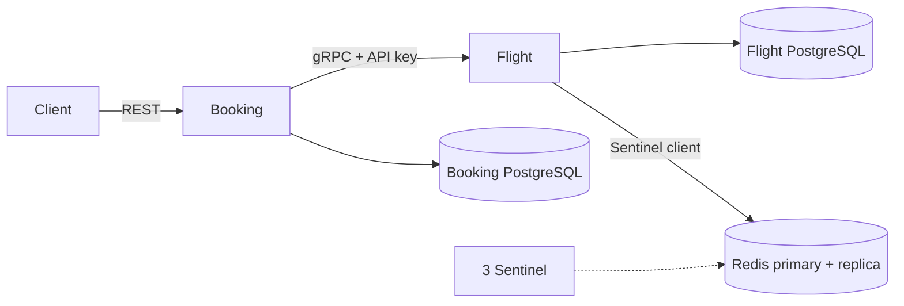
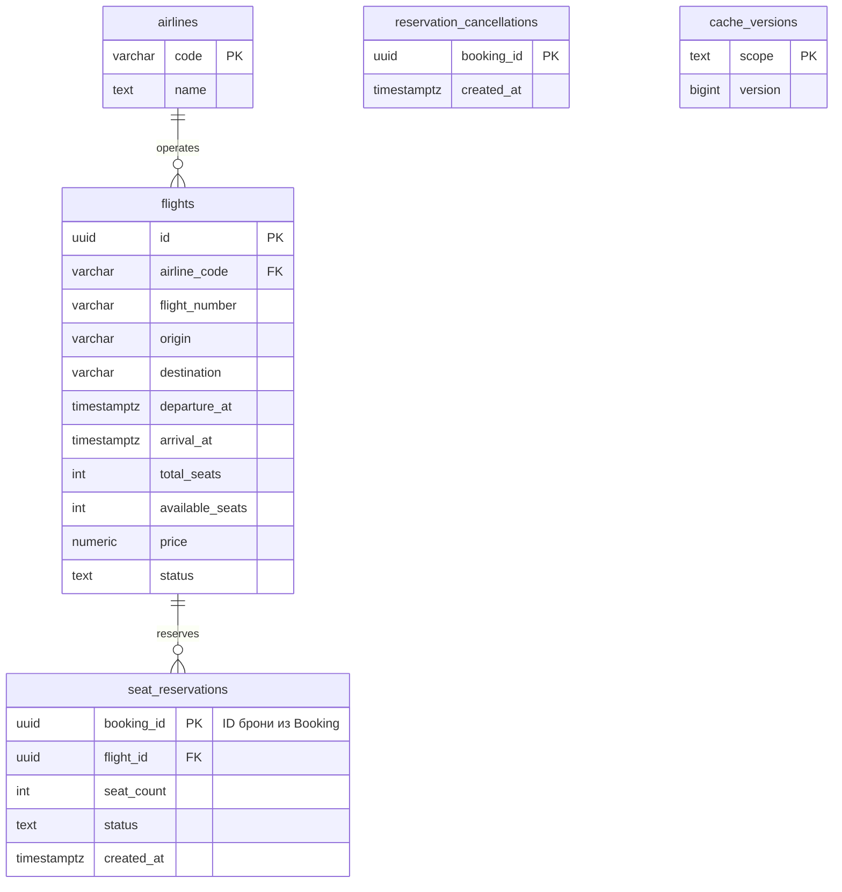
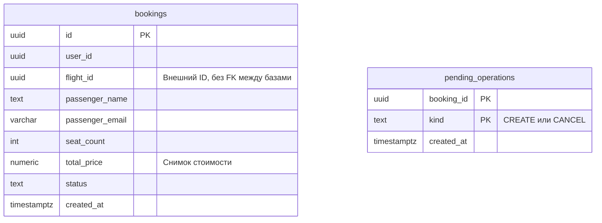

# ДЗ 3: Flight Booking

Booking принимает REST-запросы на бронирование и вызывает Flight по gRPC. У сервисов отдельные PostgreSQL. Для кеша используются Redis с репликой и три Sentinel с кворумом 2.

## Запуск

Нужны Docker Compose и Python 3 для демо. Команды выполняются из `soa/hw3`:

```bash
docker compose up --build -d --wait
curl -i http://localhost:8003/health
python3 scripts/demo.py
```

Для Colima перед запуском:

```bash
unset DOCKER_HOST
export DOCKER_CONTEXT=colima
```

Swagger: http://localhost:8003/docs. gRPC: `localhost:50051`.
Настройки перечислены в [.env.example](.env.example). Для своих значений скопируй файл в `.env`. API key по умолчанию рассчитан на локальный запуск.

Миграции Flyway и генерация из [flight.proto](proto/flight.proto) выполняются автоматически. Отдельно сгенерировать Python-классы и gRPC stub:

```bash
./scripts/generate.sh
```

Файлы появятся в `.generated/`.

Остановка с сохранением данных PostgreSQL:

```bash
docker compose down
```

## Сервисы



## API

| Booking REST API | Действие |
|---|---|
| `GET /flights?origin=SVO&destination=LED` | Поиск SCHEDULED-рейсов; можно добавить `date=YYYY-MM-DD` |
| `GET /flights/{id}` | Информация о рейсе |
| `POST /bookings` | Создать бронь |
| `GET /bookings/{id}` | Бронь по ID |
| `GET /bookings?user_id={uuid}` | Брони пользователя |
| `POST /bookings/{id}/cancel` | Отменить бронь и вернуть места |

В миграции есть два рейса из SVO в LED: на 50 мест и на одно место. `scripts/demo.py` создаёт и отменяет брони, проверяет ошибки и запускает два запроса на последнее место. После прогона места возвращаются, отменённые брони остаются в базе.

В Flight пять RPC: `SearchFlights`, `GetFlight`, `ReserveSeats`, `ReleaseReservation`, `UpdateFlight`. Все проверяют `x-api-key` из metadata. Ключ передаётся сервисам через окружение; без него Flight возвращает `UNAUTHENTICATED`. Контракты и коды ошибок описаны в `.proto`.

## Данные

Flight PostgreSQL:



Booking PostgreSQL:



Схемы в 3NF: название авиакомпании хранится в `airlines`, данные пассажира относятся к конкретной брони. `total_price` фиксирует стоимость при бронировании. Общих таблиц и внешних ключей между базами нет.

Ограничения БД проверяют цену, количество мест, IATA-коды, время прилёта и статусы. Номер рейса вместе с датой вылета в UTC уникален. Одному `booking_id` соответствует одна резервация.

## Транзакции и сбои

Flight блокирует рейс через `SELECT FOR UPDATE`. Списание мест и создание резерва проходят одной транзакцией, возврат мест и отмена резерва тоже. Повторный `ReserveSeats` с тем же `booking_id` и параметрами возвращает существующий ACTIVE-резерв. Повторный `ReleaseReservation` не возвращает места второй раз.

Booking получает цену через `GetFlight`, вызывает `ReserveSeats` и сохраняет бронь со стоимостью `seat_count * flight.price`.

Если сохранить бронь не удалось, Booking освобождает резерв. Незавершённые операции хранятся в `pending_operations`, фоновый обработчик продолжает их после сбоя. Отмена неизвестного резерва оставляет отметку в `reservation_cancellations`, которая запрещает запоздавшему запросу списать места.

Общей транзакции между двумя БД нет: при сбоях изменения отменяются или завершаются отдельными вызовами. Идемпотентность по `booking_id` действует для gRPC; повторный REST `POST /bookings` считается новой попыткой бронирования.

- Retry и circuit breaker находятся в клиентском gRPC-interceptor. Максимум три попытки с паузами 100 и 200 мс, только для `UNAVAILABLE` и `DEADLINE_EXCEEDED`.
- После пяти неудачных RPC подряд за 30 секунд circuit открывается на 10 секунд и сразу возвращает HTTP 503. Затем пропускает один пробный вызов: успешный ответ закрывает circuit, транспортная ошибка открывает снова. Параметры задаются окружением, переходы состояний видны в логах.
- Кеш работает по Cache-Aside с TTL 300 секунд: ключи `flight:{id}` и `search:{origin}:{destination}:{date}`. `UpdateFlight`, `ReserveSeats` и `ReleaseReservation` удаляют данные рейса и поиска по его маршруту. Перед выдачей кеша проверяется версия в PostgreSQL, поэтому даже cache hit требует чтения БД. При сбое Redis данные берутся из PostgreSQL.
- Sentinel переключает Redis на реплику при отказе основного узла. Все контейнеры находятся на одной машине, отказ всей машины эта схема не покрывает.

gRPC работает внутри Docker-сети без TLS. Пользовательской авторизации в REST нет.

## Команды для проверки

```bash
docker compose ps --all
docker compose logs --tail=40 booking flight
docker compose exec booking-db psql -U booking -d booking -c 'SELECT * FROM bookings;'
docker compose exec flight-db psql -U flight -d flight -c 'SELECT id, available_seats FROM flights;'
docker compose exec flight-db psql -U flight -d flight -c 'SELECT * FROM seat_reservations;'
```

Узнать текущий основной Redis:

```bash
docker compose exec sentinel-1 redis-cli -p 26379 SENTINEL get-master-addr-by-name flights-cache
```
