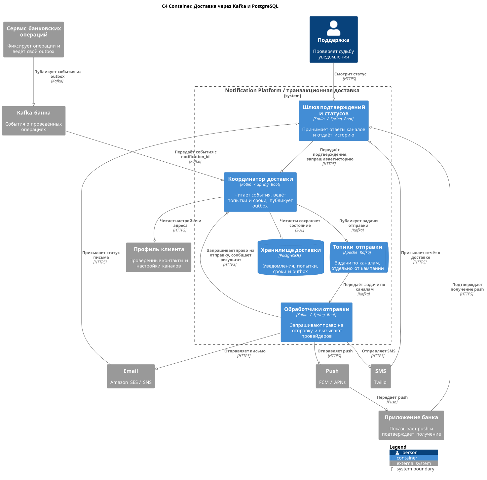
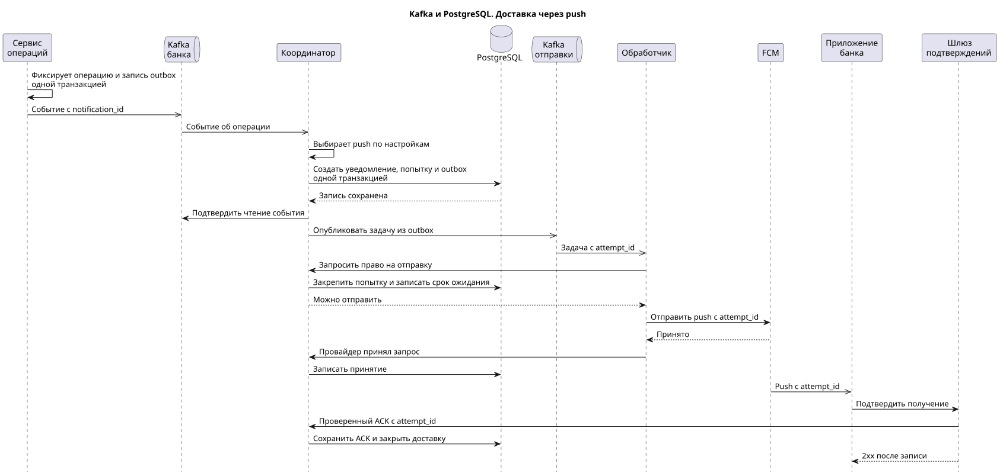
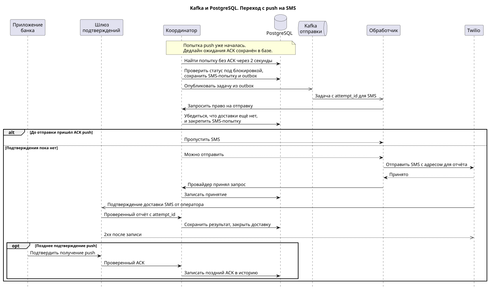
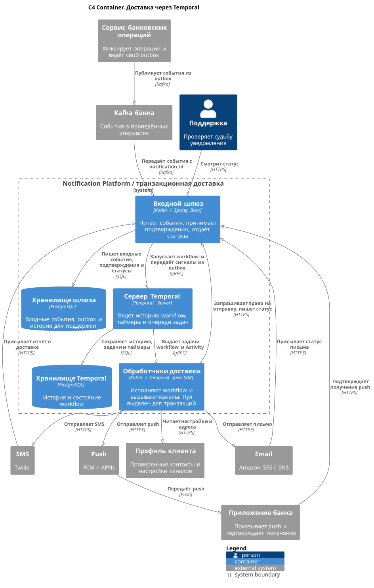
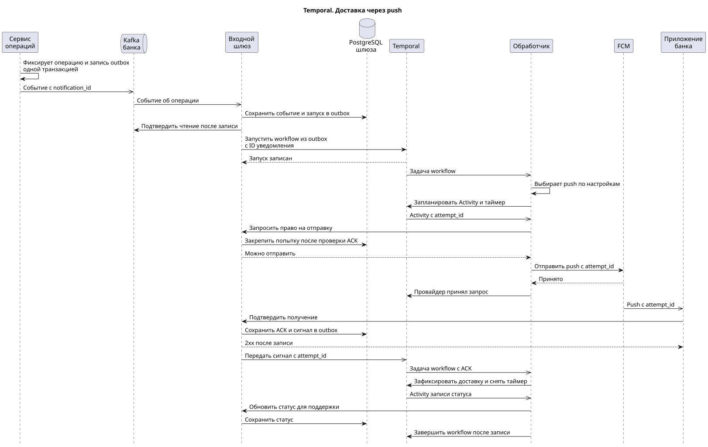
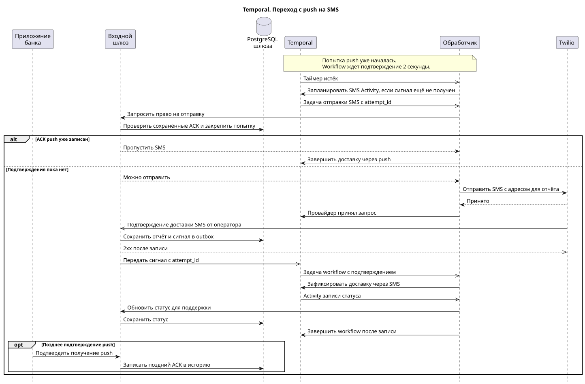

# RFC. Гарантированная доставка критичных уведомлений с переключением между каналами

| Метаданные | Значение |
| --- | --- |
| Статус | DESIGN |
| Автор(ы) | Учебный проект |
| Ответственный | Команда платформы уведомлений |
| Бизнес-заказчик | Команда онлайн-банка |
| Ревьюеры | |
| Дата создания | 2026-11-11 |
| Дата обновления | 2026-11-12 |

## Оглавление

1. [Контекст](#контекст)
2. [Продуктовый анализ](#продуктовый-анализ)
3. [Пользовательские сценарии](#пользовательские-сценарии)
4. [Статистика](#статистика)
5. [Требования](#требования)
6. [Варианты решения](#варианты-решения)
7. [Сравнительный анализ](#сравнительный-анализ)
8. [Выводы](#выводы)
9. [Связанные задачи](#связанные-задачи)
10. [Приложения](#приложения)

## Контекст

Команды банка отправляют уведомления из разных сервисов. Из-за задержек и дублей клиенту трудно понять, что произошло с деньгами, а поддержка видит только часть истории. Единая платформа берёт на себя доставку и хранит историю попыток.

### Границы гарантии

Доставка начинается после фиксации списания или перевода. Кампании и сервисные сообщения идут отдельно. Событие переживает отказ экземпляра или зоны (Н4). При доступном канале действуют цели по времени из Н1 и Н2. Если подтверждение не пришло, случай остаётся в журнале и уходит на разбор. Метрики считают подтверждение по каналу.

## Продуктовый анализ

Рост удержания и снижение числа жалоб считаем относительно исходного уровня. На пилоте сравним удержание на 30-й день и жалобы в сопоставимых группах за одинаковый период. Жалобы считаем также на тысячу уведомлений, чтобы учесть объём рассылок. Для критичных уведомлений измерим подтверждения в срок, дубли и расход SMS.

## Пользовательские сценарии

| Приоритет | Тип сценария | Действующее лицо | Сценарий |
| --- | --- | --- | --- |
| MUST HAVE | Обычная доставка | Клиент | После списания получает push и может проверить операцию в приложении. |
| MUST HAVE | Переключение канала | Клиент | Если push не подтвердился вовремя, получает сообщение по резервному каналу. |
| MUST HAVE | Настройки | Клиент | Выбирает предпочтительный канал для критичных уведомлений. |
| MUST HAVE | Разбор сбоя | Дежурный | Получает случай на разбор, когда срок автоматических попыток истёк без подтверждения. |
| SHOULD HAVE | Помощь клиенту | Поддержка | По ID операции или уведомления находит попытки и объясняет задержку. |

## Статистика

Суточный поток считаем по 3 млн активных пользователей (DAU). MAU 10 млн задаёт порядок числа профилей. Пик в 300 тыс. одновременных пользователей сам по себе не даёт частоту операций.

| Поток | Уведомлений на человека в день | Всего в день | В среднем в секунду |
| --- | ---: | ---: | ---: |
| Транзакционный | 2 | 6 млн | 69 |
| Сервисный | 3 | 9 млн | 104 |
| Маркетинговый | 5 | 15 млн | 174 |
| Всего | 10 | 30 млн | 347 |

## Требования

[Требования ко всей платформе и обоснование ASR](README.md).

### Функциональные требования

| № | Приоритет | Обозначение | Требование |
| --- | --- | --- | --- |
| 1 | MUST HAVE | Ф1–Ф2 | Принимать критичные уведомления от банковских сервисов, доставлять их через push, SMS или email и переключаться на резерв при отказе или задержке подтверждения. |
| 2 | MUST HAVE | Ф3 | Учитывать предпочтительный канал клиента и доступность контактов. Уведомления о движении денег остаются включёнными. |
| 3 | MUST HAVE | Ф5 | Обрабатывать повтор заявки под тем же ID. После подтверждения прекращать новые попытки. |
| 4 | MUST HAVE | Ф6 | Хранить итог и историю попыток. Если подтверждения нет через 15 минут, передавать случай на разбор. |

### Нефункциональные требования

| № | Приоритет | Обозначение | Требование |
| --- | --- | --- | --- |
| 1 | MUST HAVE | Н1 | В штатном режиме 95% сообщений подтверждаются за 2 секунды для push и за 15 секунд для SMS и email при доступном основном канале. |
| 2 | MUST HAVE | Н2 | При отказе основного канала 99,9% сообщений с доступным резервом подтверждаются за 60 секунд. |
| 3 | MUST HAVE | Н3 | Кампания на миллион получателей обрабатывается за 15 минут при расчётном пике с соблюдением Н1. |
| 4 | MUST HAVE | Н4 | При отказе экземпляра или зоны сохраняются зафиксированные события. Обработка возобновляется за 5 минут. |
| 5 | MUST HAVE | Н5 | Для одного события создаётся одна запись. После сохранения подтверждения новые разрешения на отправку не выдаются. |
| 6 | MUST HAVE | Н6 | Новый статус виден поддержке за 5 секунд. Тревога об отказе канала приходит за минуту. |

Время Н1 и Н2 считаем от фиксации операции. Пороги проверяем на пилоте. Уведомления без своевременного подтверждения считаем промахами.

### Расчёт нагрузок

Критичный пик для теста берём в десять раз выше среднего, около 695 уведомлений в секунду. Кампания на миллион получателей за 15 минут даёт около 1 111 задач в секунду. Вместе со 104 сервисными это около 1 910 входных задач в секунду. Кампания входит в суточный объём маркетинга.

Три канала на одно уведомление дают до 2 085 обращений в секунду до повторов. При массовом отказе push резерв должен принять до 695 SMS в секунду, если у всех есть телефон. Этот лимит нужно подтвердить у провайдера. Для Temporal проверяем ещё 695 стартов Workflow в секунду и хранение истории при 6 млн запусков в день. Если запись критичного уведомления занимает 1 КБ, за 30 дней набирается около 180 ГБ до учёта попыток, индексов и реплик.

Если на SMS переключается 1% критичных уведомлений, получаем около 60 тыс. SMS в сутки. При суточном отказе push и доступной SMS у всех получится до 6 млн SMS до повторов. Расход считаем по числу попыток и тарифам. При превышении порога расходов дежурный получает тревогу, обычные рассылки замедляются, критичные сохраняют свою квоту.

## Варианты решения

В обоих вариантах сервисы и воркеры работают в нескольких зонах. У каждой PostgreSQL, включая банковскую БД с outbox, две реплики в других зонах. Коммит ждёт подтверждения одной реплики. При отказе основной БД автоматически переключаемся на реплику с подтверждёнными записями, вторая остаётся для синхронной записи.

### Что считаем подтверждением

| Канал | Подтверждение |
| --- | --- |
| Push через FCM или APNs | ACK от приложения банка. Ответ провайдера сообщает о приёме запроса. ACK в фоне проверяем на пилоте. [Отчётность FCM](https://firebase.google.com/docs/cloud-messaging/understand-delivery) |
| SMS через Twilio | Квитанция `delivered`. Источник подтверждения зависит от оператора. Проверяем качество квитанций на целевых маршрутах. [Статусы Twilio](https://www.twilio.com/docs/messaging/api/message-resource#message-status-values) |
| Email через Amazon SES | Событие `Delivery` от SES через SNS. Письмо принял сервер получателя. [События Amazon SES](https://docs.aws.amazon.com/ses/latest/dg/event-publishing-retrieving-sns-contents.html#event-publishing-retrieving-sns-contents-delivery-object) |

### Порядок отправки

1. Начинаем с выбранного клиентом канала, если он доступен и контакт подтверждён. По умолчанию пробуем push, SMS, затем email. SMS идёт перед письмом ради скорости. Перед отправкой проверяем, что контакт актуален.
2. При явном отказе сразу пробуем резерв. В остальных случаях от начала попытки ждём подтверждения до 2 секунд для push и до 10 секунд для SMS или email. В это окно можно уточнить статус у провайдера. Если подтверждения нет, исход неизвестен и платформа пробует следующий канал.
3. Временные сбои проверяем через 30 секунд, 2 минуты и 5 минут от первой попытки. После подтверждённого временного отказа повторяем отправку. При неизвестном исходе повторяем с тем же ключом, если провайдер отсекает дубли. Иначе ищем квитанцию и пробуем резерв.
4. Первое подтверждение закрывает уведомление. Если оно записано до выдачи разрешения на SMS, воркер пропускает отправку. Если разрешение уже выдано, клиент может получить SMS и поздний push. Обе квитанции попадут в историю. Повторные push приложение отсеивает по ID уведомления.
5. Через 15 минут без подтверждения прекращаем автоматические попытки, ставим статус «Нет подтверждения» и передаём случай на разбор. Если доставка подтвердилась позже, отмечаем опоздание и сохраняем промах в метриках.

Шлюз проверяет подпись квитанции или сессию приложения и находит попытку по `attempt_id` либо ID провайдера. Для списания достаточно текста «По вашей карте прошла операция. Подробности в приложении». В логах только ID, канал, время и код результата. История доступна по ролям.

### Вариант 1. Kafka и PostgreSQL

#### Архитектура

[Исходник C4](diagrams/kafka-container.puml)

Банковский сервис сохраняет операцию и запись для публикации (transactional outbox) в одной транзакции. Публикатор отправляет событие с постоянным `notification_id` в Apache Kafka. У критичного топика три реплики в разных зонах, `acks=all`, минимум две синхронные реплики. Выбор отставшей реплики лидером отключён.

Координатор на Kotlin и Spring Boot сохраняет уведомление с уникальным `notification_id` в PostgreSQL и затем подтверждает чтение в Kafka. В той же БД хранит сроки, попытки и outbox. Попытку и задачу записывает одной транзакцией, публикатор переносит задачу в Kafka.

Воркер получает разрешение у координатора до вызова провайдера. Координатор выдаёт его на ограниченное время и под той же блокировкой строки записывает квитанции и проверяет сроки. Планировщик ищет просроченные попытки по индексу `next_action_at`. Если воркер пропал и разрешение истекло, исход считается неизвестным. Повтор события или задачи проходит те же проверки. Ответ «Принято» пишем в историю без изменения подтверждённого статуса. [Семантика доставки Kafka](https://kafka.apache.org/41/design/design/#semantics)

#### Обычная доставка

[PlantUML](diagrams/kafka-delivery.puml)

#### Переключение на SMS

[PlantUML](diagrams/kafka-failover.puml)

#### Этапы реализации

| Этап | Описание | Планируемый срок | Ресурсы | Риски |
| --- | --- | --- | --- | --- |
| 1 | Вход из Kafka, таблицы уведомлений и попыток, outbox. | 1 неделя | Backend, инфраструктура | Повтор событий при переключении с прежней отправки. |
| 2 | Планировщик, каналы, квитанции и история. | 2 недели | Backend, команда приложения | Гонка поздней квитанции с запуском SMS. |
| 3 | Нагрузка, отказ зоны и пилот на одном типе операций. | 1 неделя | Backend, инфраструктура, тестирование | Лимиты SMS и задержки подтверждений. |

#### Преимущества

- Входные события уже идут через Kafka. Сроки, попытки и история лежат в одной PostgreSQL.

#### Недостатки

- Нужно реализовать планировщик и защиту от гонок при переключении. При массовом отказе push вырастет нагрузка на выборку просроченных попыток.

### Вариант 2. Temporal

#### Архитектура

[Исходник C4](diagrams/temporal-container.puml)

Сервис на Kotlin и Spring Boot читает тот же топик Kafka и сохраняет событие и заявку на запуск Workflow в PostgreSQL. Повторяет запуск с `notification_id` в качестве Workflow ID. С политикой `REJECT_DUPLICATE` завершённый Workflow с этим ID повторно не стартует в пределах срока хранения истории. Ответ «Уже запущен» закрывает заявку для того же события. Повторы запуска ограничены сроком хранения истории. Входные записи храним дольше этого срока и окна повторов Kafka.

Temporal хранит состояние и таймеры в отдельной PostgreSQL. Воркеры на Temporal Java SDK вызывают провайдеров через Activities. До вызова шлюз в одной транзакции проверяет подтверждения и закрепляет попытку с постоянным `attempt_id`. После сбоя Activity сверяет журнал и уточняет статус либо возвращает управление Workflow для перехода на резерв. Повторы ограничены окном канала.

Шлюз сохраняет квитанцию и через outbox сигнализирует Workflow. Workflow отбрасывает повторные сигналы. После завершения Workflow поздние квитанции остаются только в истории для поддержки. [Workflow ID](https://docs.temporal.io/workflow-execution/workflowid-runid), [Повторы Activities](https://docs.temporal.io/activities)

#### Обычная доставка

[PlantUML](diagrams/temporal-delivery.puml)

#### Переключение на SMS

[PlantUML](diagrams/temporal-failover.puml)

#### Этапы реализации

| Этап | Описание | Планируемый срок | Ресурсы | Риски |
| --- | --- | --- | --- | --- |
| 1 | Развернуть Temporal, настроить его БД и очереди. | 1 неделя | Инфраструктура, backend | Команде нужно освоить поддержку нового кластера. |
| 2 | Вход из Kafka, Workflow, Activities, сигналы и история для поддержки. | 3 недели | Backend, команда приложения | Сбой после внешнего вызова, задержка обновления истории. |
| 3 | Нагрузка на запуск Workflow, отказ зоны и пилот. | 1 неделя | Backend, инфраструктура, тестирование | Пиковая задержка таймеров и рост истории. |

#### Преимущества

- Temporal восстанавливает Workflow и таймеры. Новые правила доставки по продуктам добавляются в один сценарий.

#### Недостатки

- Нужны кластер Temporal и отдельная БД истории. Статус для поддержки обновляется отдельной операцией. Повторы вызова провайдера требуют проверки попытки.

## Сравнительный анализ

### Ресурсные требования

Оценки предполагают доступ к провайдерам и команду из двух backend-разработчиков, инженера инфраструктуры и тестировщика. Для push ACK нужна помощь команды мобильного приложения.

| Критерий | Вариант 1. Kafka и PostgreSQL | Вариант 2. Temporal |
| --- | --- | --- |
| Время до первого пилота | Около 4 недель. | Около 5 недель. |
| Команда | Backend ведёт планировщик и логику переходов. | Backend ведёт Workflow и Activities, инфраструктура берёт Temporal в поддержку. |
| Инфраструктура | Kafka, PostgreSQL и воркеры. | Kafka на входе, Temporal с отдельной PostgreSQL, БД шлюза и воркеры. |
| Организационные риски | Нужен ответственный за повторы и разбор зависших отправок. | Нужен опыт работы с Temporal и готовность дежурных поддерживать его. |

### Соответствие требованиям

| ASR | Связанные требования | Kafka и PostgreSQL | Temporal |
| --- | --- | --- | --- |
| A1. Восстановление | Ф1–Ф2, Н2, Н4 | Координатор принимает события и переключает каналы. После сбоя продолжает по попыткам, срокам и outbox в PostgreSQL. | Workflow переключает каналы по таймеру или отказу. Temporal восстанавливает ход работы, outbox сохраняет запуски и сигналы. |
| A2. Задержка на пике | Н1–Н3 | Выделенные топики и воркеры. При массовом сбое push проверяем скорость планировщика. | Выделенные очереди Activities и воркеры. Проверяем скорость старта Workflow и срабатывания таймеров. |
| A3. Каналы и повторы | Ф3, Ф5, Н5 | Координатор выбирает канал по настройкам. Уникальный ID и блокировка строки защищают выдачу разрешения и запись квитанции. | Workflow выбирает канал по настройкам. Один Workflow на уведомление, шлюз сверяет квитанции перед вызовом. |
| A4. История | Ф6, Н6 | Поддержка читает попытки и статусы из PostgreSQL. | Шлюз хранит копию статуса для поддержки. Задержка копии входит в Н6. |

В обоих вариантах резервируем квоты для критичных отправок и пропускаем недоступный канал до его восстановления. В Grafana смотрим метрики Prometheus и трассировки Tempo. Для разбора сбоев нужны время до подтверждения, возраст старейшего задания, доля переключений, поздние квитанции, подтверждения по нескольким каналам и расход SMS. Часть дублей можно узнать только из жалоб.

## Выводы

Для первого релиза выбираем Kafka и PostgreSQL. Kafka уже нужна для событий банка, а один планировщик покрывает переходы между тремя каналами, если выдерживает расчётный пик. К Temporal можно вернуться, когда у продуктов появятся свои длинные сценарии и таймеры.

Короткое ожидание push ускоряет резерв, но повышает расход SMS и риск дублей. В первом релизе приоритет у скорости. На пилоте уточним окно по расходу SMS и доле подтверждений по нескольким каналам.

### Проверка перед запуском

Повторяем событие, останавливаем воркер после вызова провайдера, теряем ответ, меняем порядок квитанций и отключаем одну зону. Совмещаем кампанию на миллион получателей с пиком и отдельно проверяем отказ push. Сверяем журнал и метрики с Н1–Н6.

## Связанные задачи

- Согласовать, какие банковские операции публикуют событие, и зафиксировать формат `notification_id`.
- Проверить push ACK на iOS и Android, согласовать формат квитанций и лимиты SMS и email.
- Начать пилот с одного типа операций. Переключать источник отправки по типу операции, чтобы старый сервис и платформа не дублировали уведомления. Расширять охват после проверки задержек, жалоб и расхода SMS.

## Приложения

### Глоссарий

| Термин | Значение |
| --- | --- |
| ASR | Требование, которое влияет на выбор архитектуры. |
| ACK | Подтверждение от приложения банка, что оно получило push. |
| Failover | Переход на резервный канал при отказе или отсутствии подтверждения. |
| Outbox | Записи для отправки, которые сохраняются вместе с изменением состояния в одной транзакции. |
| Workflow | Сценарий в Temporal, который хранит ход доставки и ждёт таймеры или сигналы. |
| Activity | Шаг Workflow с внешним действием, например вызовом SMS-провайдера. |
