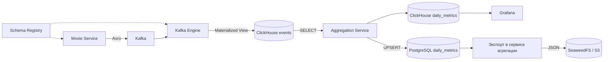

# ДЗ 5. Аналитика онлайн-кинотеатра

## Запуск

```bash
cd hw5
docker compose up --build -d --wait
docker compose exec movie python -m cinema.generate --users 30 --days 14
```

Первая команда Compose поднимает стенд, создаёт топик, регистрирует схему и применяет SQL. Генератор добавляет синтетические просмотры за последние 14 дней. Метрики появятся после ближайшего пересчёта, обычно через полминуты.

Если Docker работает через Colima, эти команды выбирают отдельный профиль с 6 ГБ памяти. Выполни их перед запуском Compose.

```bash
colima start soa-hw5 --cpus 4 --memory 6 --disk 40 --activate=false
unset DOCKER_HOST
export DOCKER_CONTEXT=colima-soa-hw5
```

- [Grafana](http://localhost:3005/d/cinema-analytics) показывает когорты Day 0–7, DAU, конверсию и рейтинг фильмов.
- [Movie API](http://localhost:8005/docs) принимает JSON через `POST /events`. Время передавай с часовым поясом. Для событий просмотра нужен `progress_seconds`.
- [Aggregation API](http://localhost:8006/docs) даёт вручную пересчитать день и выгрузить его метрики.

```bash
DAY=2026-04-07
curl -fsS -X POST "http://localhost:8006/aggregate/$DAY"
curl -fsS -X POST "http://localhost:8006/export/$DAY"
```

Для ручного пересчёта подставь дату с событиями.

```bash
docker compose run --build --rm test
```

Тест отправляет собственные события, ждёт их в ClickHouse и проверяет схему, значения метрик и JSON в S3. Команда `docker compose down` останавливает стенд и сохраняет данные в томах.

## Как идут данные



Топик `movie-events` содержит три партиции, у каждой три реплики. Ключ `user_id` направляет события пользователя в одну партицию и сохраняет порядок записи в ней. Продюсер ждёт `acks=all` и повторяет временные ошибки с растущей паузой. Две синхронные реплики позволяют писать при остановке одного брокера.

ClickHouse читает Avro по схеме из Registry. Исходные события лежат в партициях по месяцу. Порядок `(event_date, user_id, event_id)` помогает фильтровать по дню и отбрасывать повторы доставки, когда у события те же дата, пользователь и ID. [Схема Avro v1](schemas/movie-event-v1.avsc) · [Таблицы ClickHouse](db/clickhouse.sql).

## Метрики и экспорт

День считается по UTC. DAU включает пользователей с любым событием. Для топа считаются начатые просмотры. Среднее время берётся из завершённых просмотров, конверсия делит число завершённых просмотров за день на число начатых за тот же день.

Когорта начинается в день первого `VIEW_STARTED`. Day 1 и Day 7 показывают, какая доля когорты совершила любое действие в этот день. Для будущих дней значение пустое. [Расчёт за день](db/daily.sql) · [Когорты](db/retention.sql).

По умолчанию сервис пересчитывает текущий день, вчерашний и даты с событиями за последние две недели. Интервал задаёт `AGGREGATION_INTERVAL_SECONDS`. ClickHouse меняет партицию за день целиком. PostgreSQL обновляет строки по дате, метрике и её измерению (фильм или день когорты).

За прошедшие дни сервис выгружает JSON в `s3://movie-analytics/daily/YYYY-MM-DD/aggregates.json`. Когда метрики меняются, файл обновляется по тому же ключу. При сбое запись остаётся в очереди в PostgreSQL до следующего цикла.
